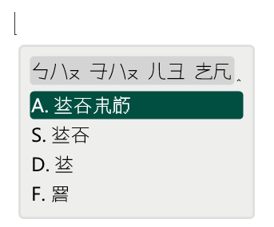

# Rime Phun / 栄言印具
[Rime IME](https://rime.im)で動作する、人工言語「[雰語](https://kaeru2193.net/phunlang)」のラテン文字転写（雰拼）入力スキーマです。


## 導入方法
1. お使いの端末に[Rime IME](https://rime.im)が導入されていない場合は、初めに導入してください。また、このスキーマは雰字フォントでの表示を前提に設計されています。予め端末に[PhunSans](https://kaeru2193.net/download/font/phunsans/)と[PhunDot](https://kaeru2193.net/download/font/phundot/)をインストールしておくことを推奨します。
2. Rime IMEのユーザーディレクトリ（Windowsなら`%APPDATA%/Rime/`）に、以下の内容をコピーしてください。
    * `lua/` ディレクトリ
    * `rime.lua`
    * `phun.schema.yaml`
    * `phun.dict.yaml`
3. ユーザーディレクトリの`default.custom.yaml`の`patch/schema_list`に、以下の行を追加します。
    ```
    - {schema: phun}
    ```
4. `Deploy`を実行し、正常に読み込まれると雰語入力が使用可能になります。

または、[plum（東風破）](https://github.com/rime/plum)を使用して導入することもできます。

## 使用方法
* 声調は省いても変換できますが、候補が多すぎる場合には音節の後ろに`1`、`2`、`3`を入力して声調を指定できます。
* 変換候補は上から順に`Shift` + `a`、`s`、`d`、`f`、`g`で選択できます。
* デフォルトでは数字キーを押すと算字（bùoqô）が入力されます。但し`0`で「〹（A）」、`-`で「〺（B）」、`^`で「〇（0）」が入力されることに注意してください。
* Rime IMEのメニュー（デフォルトでは`F4`）から、雰字↔英数字入力の切り替え、数字キーを押した際に算字↔雰字のどちらを入力するかの切り替えができます。

## その他
`phun.dict.yaml`は、毎月1日のUTC 0:00に[雰語辞書データ](https://kaeru2193.github.io/Phun-Resources/dict/phun-dict.json)を元に自動で更新されます。定期的にローカル環境の辞書も更新することを推奨します。